# Human Robot Simulation Field · MuscleMimic

基于 MuJoCo、JAX/MJX Warp 的肌骨运动模仿学习与人机交互仿真项目。人体模型来自 `models/myo_sim`，通过统一 Assist 环境进行重映射与训练。当前维护的任务配置包括 **walk、run、bend、lift，以及右手持哑铃和双手夹持箱子的负载微调**，这些任务使用 `myofullbody` 全身模型。

## 已学习的动作与物体交互

点击动图可打开对应的 MP4 视频。

| 行走 · walk | 跑步 · run |
|:---:|:---:|
| [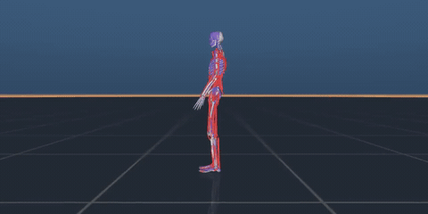](https://github.com/mxhjs29/human-robot-sim-field/raw/refs/heads/main/assets/demos/walk.mp4) | [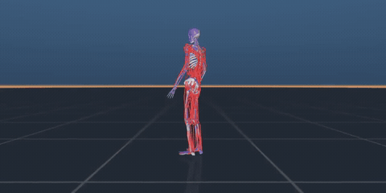](https://github.com/mxhjs29/human-robot-sim-field/raw/refs/heads/main/assets/demos/run.mp4) |
| [▶ 行走视频](https://github.com/mxhjs29/human-robot-sim-field/raw/refs/heads/main/assets/demos/walk.mp4) | [▶ 跑步视频](https://github.com/mxhjs29/human-robot-sim-field/raw/refs/heads/main/assets/demos/run.mp4) |

| 弯腰搬箱 · bend · 1 kg | 哑铃举臂 · lift · 2 kg |
|:---:|:---:|
| [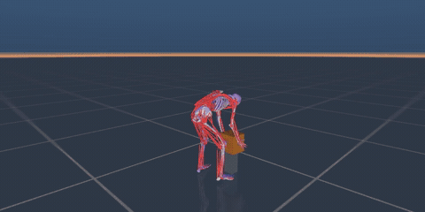](https://github.com/mxhjs29/human-robot-sim-field/raw/refs/heads/main/assets/demos/bend.mp4) | [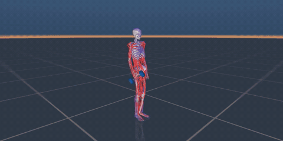](https://github.com/mxhjs29/human-robot-sim-field/raw/refs/heads/main/assets/demos/lift.mp4) |
| [▶ 搬箱视频](https://github.com/mxhjs29/human-robot-sim-field/raw/refs/heads/main/assets/demos/bend.mp4) | [▶ 哑铃视频](https://github.com/mxhjs29/human-robot-sim-field/raw/refs/heads/main/assets/demos/lift.mp4) |

## 发布内容

| 位置 | 内容与作用 |
|---|---|
| GitHub | 仿真代码、三个模型包、训练/任务配置、奖励、数据工具、测试、协作说明 |
| GitHub：`assets/demos/` | 精选的训练后动作演示视频与 GIF 预览 |
| GitHub Git LFS：`local/assets/smpl/` | 已获授权的 SMPL-H/MANO 模型和随附许可；`musclemimic/models/smpl` 是兼容链接 |
| Hugging Face | 保留仓库已有 KIT、CMU、Transitions_mocap、BABEL 等内容；本次仅新增 Gait120 S101–S110 原始来源文件及 SHA256 清单 |
| 本地 `outputs/` | PPO checkpoint、日志、视频与报告 |
| 本地 `converted_datasets/`、`datasets/output/` | 本项目生成的重映射缓存和派生数据 |

本次 Hugging Face 上传仅补充未经本项目肌骨重映射的 Gait120 原始来源文件，未上传重映射结果或训练输出。已有仓库内容，包括历史缓存，按原样保留；下载器只选择原始数据目录。“原始”指提供者发布的文件；AMASS 是其发布的 SMPL 参数数据，Gait120 包中可包含提供者自己的处理表。本仓库的数据子集并非完整 AMASS/Gait120。

## 部署

建议 Linux、Python 3.11。模型编译与 CPU 调试不要求 GPU；规模化训练使用 NVIDIA GPU 和 MJX Warp。仓库内三个模型包以 editable 方式安装，源码和 XML/mesh/纹理均保留在各自包内。

```bash
# 系统需安装 Git、Git LFS，并确保 nvidia-smi 可用。
git clone https://github.com/mxhjs29/human-robot-sim-field.git
cd human-robot-sim-field
git lfs install
git lfs pull

# 已安装 uv 时直接执行下面两条；uv 安装见 https://docs.astral.sh/uv/
uv python install 3.11
uv sync --extra dev --extra cuda

export MUJOCO_GL=egl
export XLA_PYTHON_CLIENT_PREALLOCATE=false
export OPENBLAS_NUM_THREADS=1
export CUDA_VISIBLE_DEVICES=0  # 改为本机分配给你的 GPU
export JAX_PLATFORMS=cuda,cpu
```

只做 CPU 检查可以安装 `uv sync --extra dev`，并设置 `JAX_PLATFORMS=cpu`。缺少 OpenGL/EGL 共享库时先安装系统渲染依赖；纯服务器使用 EGL，不开启桌面 viewer。

需要从原始动作做 SMPL/GMR 重映射时再安装：

```bash
uv sync --extra dev --extra cuda --extra smpl --extra gmr
export PYTORCH_JIT=0
```

依赖版本、CUDA extra 和本地模型包路径由 [pyproject.toml](pyproject.toml) 与 `uv.lock` 管理。避免手动混装另一套 JAX/MuJoCo。

## MSK + device + terrain 的组合

场景由 **肌骨模型（MSK）+ 可选设备（device）+ 地形（terrain）** 独立组合。肌骨模型由 `myo_sim` 构建，`assist_sim` 根据设备 YAML 执行连接、关节耦合或假肢替换，`myoassist_terrains` 生成地形；统一入口是 [musclemimic/scenes/composition.py](musclemimic/scenes/composition.py)。设备可以省略，地形默认是平地。当前依赖要求 MuJoCo ≥ 3.4。

### 肌骨模型选择

下面列出当前已通过统一入口编译的四种 `msk_key`。模型包中额外的手指、单肘等片段不等同于此入口的可选整模型。

| `myofullbody` | `myolegs` | `myolegs26` | `myoarms` |
|:---:|:---:|:---:|:---:|
| [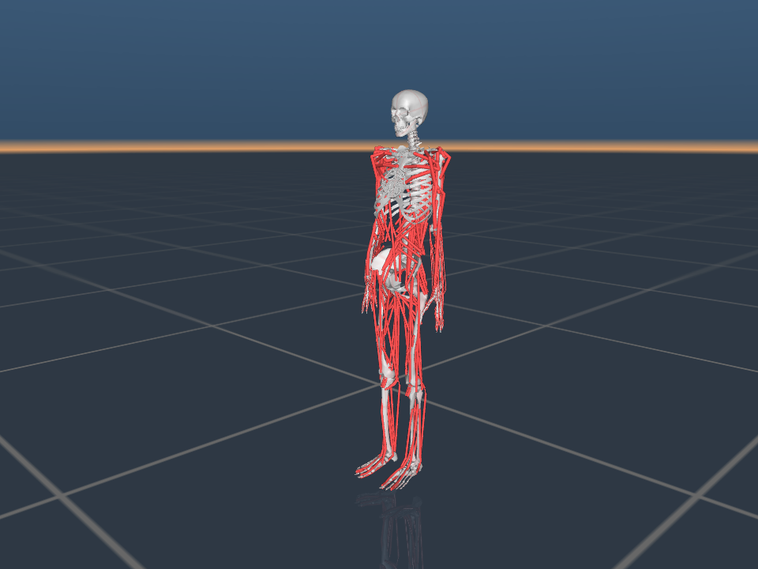](assets/readme/msk_myofullbody.png) | [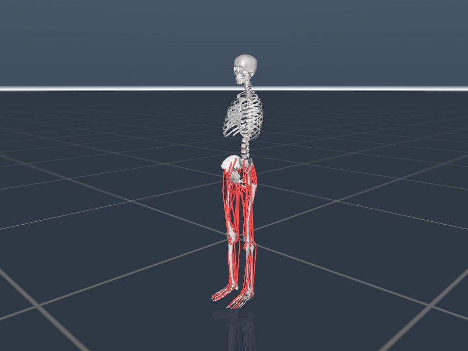](assets/readme/msk_myolegs.png) | [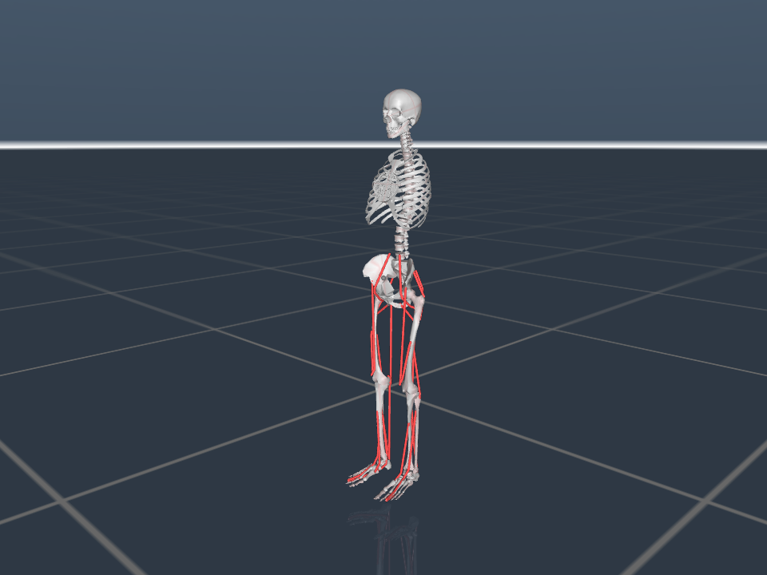](assets/readme/msk_myolegs26.png) | [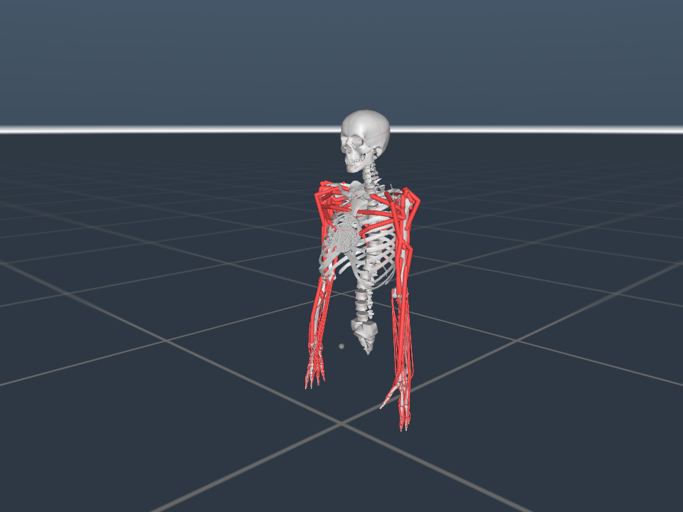](assets/readme/msk_myoarms.png) |

| `msk_key` | 模型 | 使用说明 |
|---|---|---|
| `myofullbody` | 全身肌骨模型，包含腿、躯干和双臂 | 当前 walk/run/bend/lift、哑铃和箱子训练的主模型 |
| `myolegs` | 80 肌下肢与被动躯干 | 下肢运动、下肢外骨骼和假肢组合 |
| `myolegs26` | 26 肌下肢与躯干 | 较简化的下肢组合 |
| `myoarms` | 被动躯干与双臂 | 通过 Assist 环境重映射与训练；支持肘外骨骼及独立机器人组合 |

更换肌骨模型后，应重新匹配参考轨迹、观测、动作维度和奖励；已有全身 checkpoint 不能直接用于另一个模型。

CPU 环境为 `MyoFullBodyAssistEnv`，MJX 训练环境为 `MjxMyoFullBodyAssistEnv`；实际人体模型由 `msk_key` 决定。双臂任务设置 `msk_key: myoarms`，并配置上肢参考轨迹、跟踪点和终止条件。

### 设备选择与兼容范围

`device_key: null` 表示无设备。本节展示以下四种设备/机器人，名称区分大小写；其他注册设备可通过 `assist_sim.get_available_combinations()` 查询。表中“下肢三模型”指 `myolegs26`、`myolegs` 和 `myofullbody`。

| `Hippo_L1` | `HipExoskeleton_L1` | `ElbowExoskeleton_L1` | `franka_emika_panda` |
|:---:|:---:|:---:|:---:|
| [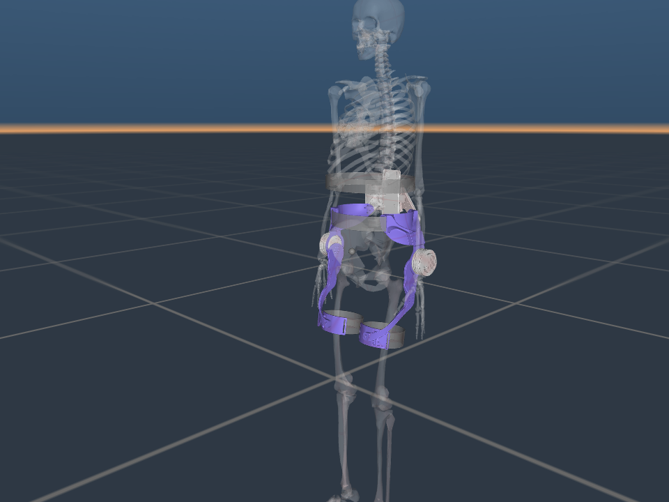](assets/readme/device_Hippo_L1.png) | [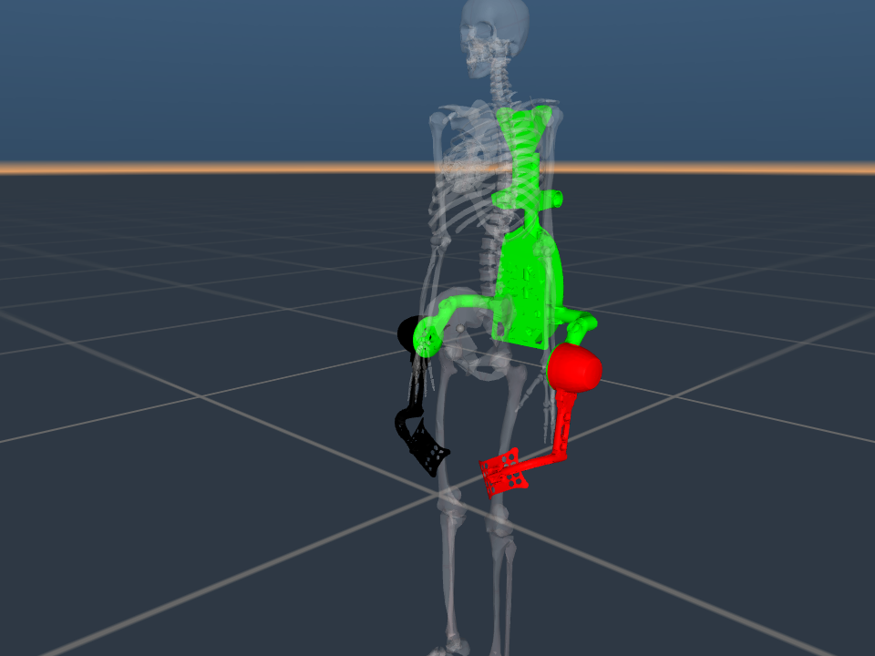](assets/readme/device_HipExoskeleton_L1.png) | [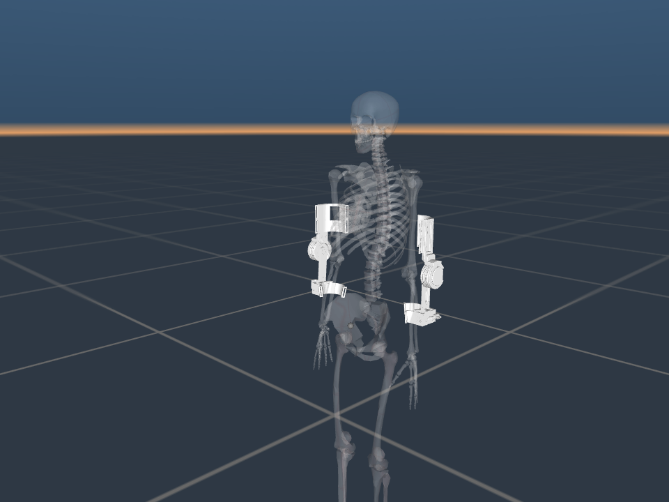](assets/readme/device_ElbowExoskeleton_L1.png) | [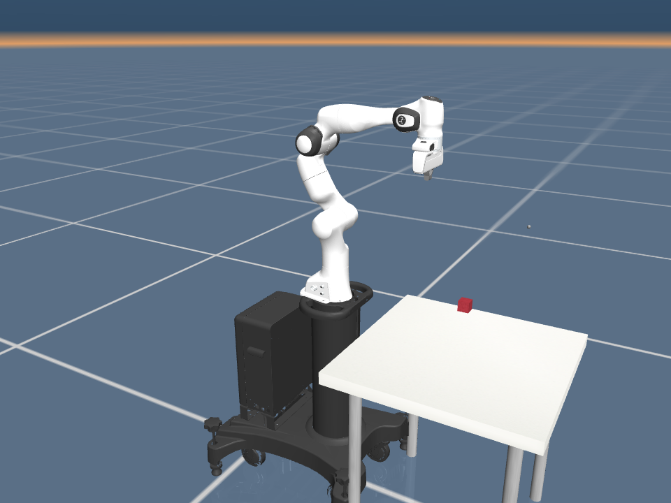](assets/readme/device_franka_emika_panda.png) |

穿戴设备图使用半透明全身模型展示安装位置；Franka 图展示独立机械臂及其支座。

| `device_key` | 设备类型 | 模型选择 |
|---|---|---|
| `Hippo_L1` | 双侧髋关节助力 | 下肢三模型 |
| `HipExoskeleton_L1` | 双侧髋外骨骼 | `myolegs`、`myofullbody` |
| `ElbowExoskeleton_L1` | 双侧肘外骨骼 | `myoarms`、`myofullbody` |
| `franka_emika_panda` | 独立 Franka Panda 机械臂及其桌面场景 | 四种 MSK；与人体共同放入世界 |

兼容声明和连接规则位于 [assist_sim 的设备资源目录](models/assist_sim/assist_sim/models)。穿戴设备依赖对应的人体连接点，最终兼容性应以实际场景编译和接触/动力学检查为准。Franka 为**独立机器人**，与人体共同放入世界，不按外骨骼方式连接。

在 `SceneSpec` 中，独立机器人使用 `kind: robot`，穿戴设备使用 `kind: device`。组合进场景不会自动产生机器人策略；当前单策略 PPO 的动作仍控制肌骨执行器，机器人需要单独的控制器/agent 路由。

### 地形选择

所有上述人体/设备组合共用 `terrain` 配置，地形选择不依赖某个设备名。

| `flat` | `slope` | `warehouse` | `stairs` |
|:---:|:---:|:---:|:---:|
| [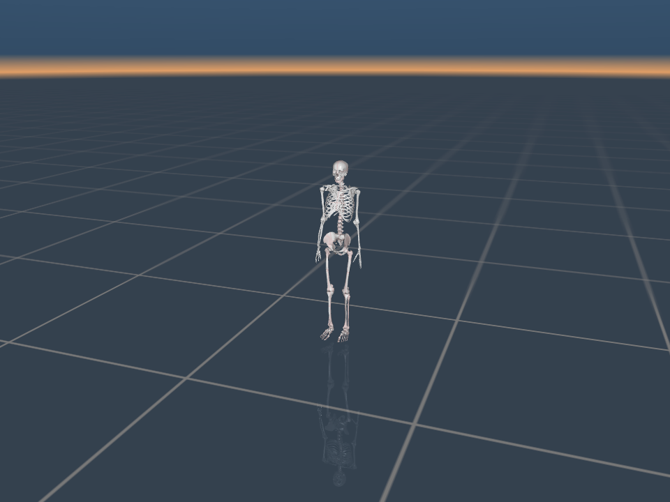](assets/readme/terrain_flat.png) | [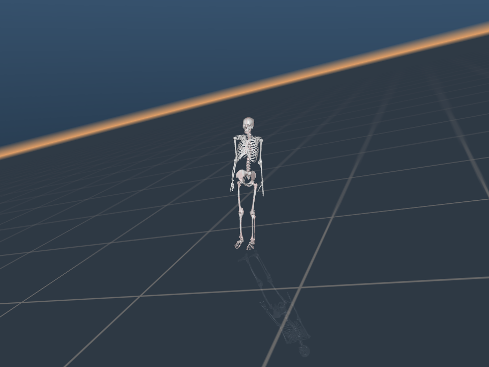](assets/readme/terrain_slope.png) | [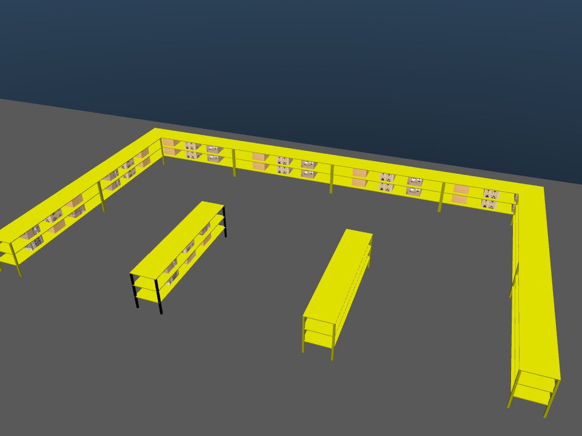](assets/readme/terrain_warehouse.png) | [](assets/readme/terrain_stairs.png) |

坡地图使用 15° 便于观察，实际坡度由 `deg` 配置；楼梯图为单个 4 m × 4 m 拼块，采用默认镜像上行/下行结构。

| 形式 | 选择 | 主要参数 |
|---|---|---|
| 连续地形 | `flat`：平地 | `extent` |
| 连续地形 | `slope`：坡地 | `deg`，单位为度 |
| 外部场景 | `warehouse`：仓库 | 可选 `scene_file`、`offset`；默认使用随仓库发布的场景 |
| 网格拼块 | `stairs`：楼梯 | `grid`、`border`、`tiles`；台阶参数包括 `step_height`、`n_steps`、`axis`、`peak_width` |

本节只展示平地、坡地、仓库和楼梯。连续地形与仓库用 `terrain: <类型>` 选择；楼梯用 `terrain_name + grid + tiles`，**不设置顶层 `terrain: stairs`**。训练参考与重置位置仍需适配地形。仓库组合保留中央货架的六个可动箱，其余货架箱作为静态、无碰撞装饰；它与箱子任务的自由负载不是同一项配置。

参数定义见 [地形配置](models/myoassist_terrains/myoassist_terrains/config.py)，拼块类型和默认参数见 [tiles](models/myoassist_terrains/myoassist_terrains/tiles)。例如两块混合地形：

```yaml
terrain:
  terrain_name: flat_and_stairs
  grid: {rows: 1, cols: 2, tile_size: [4.0, 4.0]}
  border: {width: 0.5}
  tiles:
    - {row: 0, col: 0, type: flat}
    - {row: 0, col: 1, type: stairs}
```

以上图片均由项目当前模型和场景进行 MuJoCo 静态渲染，用于展示结构与安装位置。渲染脚本与复现说明见 [图片说明](assets/readme/README.md)，不需要训练数据或 checkpoint。

### 如何配置和验证组合

场景 YAML 可以分别替换模型、设备与地形。下面是“全身 + Hippo + 5° 坡地”，保存为 `configs/scenes/fullbody_hippo_slope.yaml` 后执行 `.venv/bin/python -m musclemimic.cli.compose configs/scenes/fullbody_hippo_slope.yaml`：

```yaml
scene_id: fullbody_hippo_slope
entities:
  - {entity_id: human, kind: msk, model_key: myofullbody}
  - {entity_id: device, kind: device, model_key: Hippo_L1}
terrain: {terrain: slope, deg: 5}
```

无设备时删除 device 实体即可。已有可运行配置见 [configs/scenes](configs/scenes)：`fullbody_flat.yaml`、`fullbody_hippo.yaml`、`legs_slope.yaml`，以及带 2 kg 哑铃/5 kg 摩擦箱的 `fullbody_dumbbell.yaml`、`fullbody_box.yaml`。当前 scene builder 支持一个 MSK、至多一个设备或机器人，以及至多一个负载物体；负载通过独立的 `kind: object` 配置，不属于 `device_key`。

Python 中可查询注册候选并直接编译组合：

```python
import assist_sim
from musclemimic.scenes.composition import build_msk_device_terrain_spec

print(assist_sim.get_available_combinations())  # MSK -> 穿戴设备候选；不含独立机器人
result = build_msk_device_terrain_spec(
    msk_key="myofullbody",
    device_key="Hippo_L1",  # 无设备时传 None
    terrain={"terrain": "slope", "deg": 5},
)
model = result.spec.compile()
print(model.nq, model.nv, model.nu)
```

训练入口目前读取实验配置中的 `experiment.env_params.msk_key`、`device_key` 和 `terrain`，不会自动读取上面的场景 YAML。以全身 walk 为例，切换到 Hippo 坡地组合：

```bash
.venv/bin/python -m musclemimic.cli.train_fullbody \
  --config-name=conf_fullbody_walk \
  experiment.env_params.device_key=Hippo_L1 \
  experiment.env_params.terrain.terrain=slope \
  +experiment.env_params.terrain.deg=5 \
  experiment.env_params.device_control_mode=zero \
  experiment.env_params.num_envs=16 \
  experiment.num_envs=16 \
  experiment.ppo_config.num_minibatches=1
```

`zero` 表示设备执行器零控制，设备的质量、约束和接触仍存在；需要助力时另外配置设备控制器。环境还支持 `constant` 和 `external_torque`，其中当前外部力矩适配器要求 Hippo 的 `Exo_R/Exo_L`，不能直接套用到任意设备。模型能编译只说明场景构建成功；开始大规模训练前仍需用小批环境检查重置、承重、接触与参考跟踪。

## 机器人控制接口与外骨骼助力

### 控制边界与状态读取

场景中加入机器人/外骨骼后，人体策略与设备控制仍是两路输入：**人体策略输出肌骨动作，设备控制器输出设备命令，二者在同一物理世界中作用**。当前单策略 PPO 不会自动生成机器人动作，也不会因为设置 `device_key` 就学会助力策略。

| 接口 | 输入/输出与用途 |
|---|---|
| `env.msk_action_spec`、`env.robot_action_spec` | 人体与设备执行器名称及其顺序；不要硬编码“最后几个执行器属于机器人” |
| `env.get_robot_observation()` | CPU 下返回设备侧关节的 `qpos` 与 `qvel` 拼接；MJX 可传入 `state.data`。按组合后的关节归属取值，并非所有被助力的人体关节都在其中 |
| `include_robot_observations=True` | 将设备关节观测加入人体策略输入；会改变观测维度，已有 checkpoint 需核对兼容性 |
| `device_control_mode="zero"` | 设备执行器输入为零；设备质量、约束和接触依然存在，也不等同于机器人保持当前位置 |
| `device_control_mode="constant"` | 按 `robot_action_spec` 顺序设置固定 `device_control_value`；标量广播到全部设备执行器，向量长度必须匹配 |
| `device_control_mode="external_torque"` | 启用当前 Hippo 专用的物理力矩接口，详见下面的助力示例 |

`constant` 使用 MuJoCo 执行器的原始 `ctrl` 单位，不统一等于 N·m：位置执行器、力矩执行器、夹爪执行器的语义取决于各自 XML。`zero`/`constant` 会在环境推进前重写设备控制，因此不能靠在外部临时改一次 `data.ctrl` 来实现持续的动态控制。接口实现见 [Assist 环境](musclemimic/environments/humanoids/myofullbody_assist.py)。

### 独立机器人：单独控制，共同推进世界

对 Franka 等独立机器人，可使用现有 CPU 底层接口 [AgentSpec](musclemimic/agents/specs.py)、[ActionRouter](musclemimic/agents/routing.py) 和 [WorldRuntime](musclemimic/environments/worlds/runtime.py)。下面仅演示控制归属和一次同步推进，不包含人体平衡策略或机械臂轨迹控制：

```python
import numpy as np
from musclemimic.scenes.schemas import EntitySpec, SceneSpec
from musclemimic.scenes.builder import build_scene
from musclemimic.agents.specs import AgentSpec
from musclemimic.environments.worlds.runtime import WorldRuntime

scene = build_scene(SceneSpec(
    scene_id="human_panda_control",
    entities=(
        EntitySpec("human", "msk", "myofullbody"),
        EntitySpec("robot", "robot", "franka_emika_panda"),
    ),
))
human_ids = scene.ownership["human"].actuator_indices
robot_ids = scene.ownership["robot"].actuator_indices
agents = (
    AgentSpec("human", "human", "human_controller", human_ids, trainable=False),
    AgentSpec("robot", "robot", "robot_controller", robot_ids, trainable=False),
)
world = WorldRuntime(scene.model, agents, n_substeps=1)
world.reset()
# 这里只验证路由；实际使用时替换为控制器生成的、符合各执行器语义的 ctrl。
data = world.step({
    "human": np.zeros(len(human_ids)),
    "robot": np.zeros(len(robot_ids)),
})
```

`world.step()` 接收每个 agent 的原始执行器 `ctrl`，不执行 PPO 动作归一化转换，也不自动做控制限幅。不能把人体 PPO 的归一化动作直接当作这里的肌肉控制；需复用训练环境对应的动作转换。设备控制器也需根据执行器类型完成目标角度/力矩到 `ctrl` 的转换与限幅。

每一步必须同时提供全部 agent 的命令，执行器所有权不能重叠，当前要求 `control_period=1`；一次调用只推进 `n_substeps × model.opt.timestep` 的物理时间。机器人关节状态可通过 `scene.ownership["robot"].qpos_indices/qvel_indices` 从 `world.data` 读取。`policy_id`/`controller_type` 是描述信息，不会自动加载或调用控制器；控制器调度、任务奖励、终止和策略训练由上层 runner 实现。目前此共享世界接口是 CPU 版本，不等同于已完成多 agent 的 JAX/Warp 训练。

### 当前可用的髋外骨骼助力：Hippo 力矩接口

在已有实验的 `experiment.env_params` 中配置以下字段（仍需保留该任务的参考轨迹、奖励和重置设置）：

```yaml
msk_key: myofullbody
device_key: Hippo_L1
device_control_mode: external_torque
device_torque_limit: 5.0   # 单侧力矩绝对值上限，N·m
device_torque_slew: 100.0  # 单侧力矩变化率上限，N·m/s
```

CPU runner 在环境已初始化并 reset 后，将原来的 `env.step(muscle_action)` 替换为：

```python
import numpy as np

# muscle_action 仍由原人体策略生成；不要在其尾部拼接外骨骼动作。
# 以下为接口调用示例，非已经验证有效的助力参数。
requested_torque = np.array([2.0, 0.0], dtype=float)  # [右髋, 左髋]，N·m
obs, reward, absorbing, done, info = env.step_with_torque(
    muscle_action, requested_torque
)
```

MJX 对应调用为 `state = env.mjx_step_with_torque(state, muscle_action, requested_torque)`；这里是单环境状态的接口，批量环境由调用方用 `jax.vmap` 等方式组织。时间变化的力矩必须随状态/数组传入，不能在 JIT 后靠修改 Python 属性更新。CPU 接口检查两元素形状和有限值；MJX 调用方需保证输入形状正确且无 NaN/Inf。

当前 [HippoTorqueAdapter](musclemimic/controllers/devices/torque_adapter.py) 只接受 `Exo_R/Exo_L` 对应的理想髋关节执行器：

- 通道固定为 **`[right, left]`**，对应 `hip_flexion_r`、`hip_flexion_l`；正方向遵循模型关节坐标，当前 Hippo 配置中正值为屈髋。
- 每个环境控制步先裁剪请求力矩，再按 `device_torque_slew × env.dt` 限制变化量；控制量在该步物理子步中保持，reset 后设备控制清零。普通 `step()` 不会替你生成新助力命令，因此助力 runner 应每步调用上述专用接口。
- 适配器按编译后的固定增益和传动比把 N·m 转为 `ctrl`。当前 Hippo 增益为 100、gear 为 1，因此稳态 2 N·m 对应 `ctrl=0.02`，首次施加还受变化率限制。
- Hippo 的驱动作用于人体髋关节，这些关节不应假定出现在 `get_robot_observation()` 中；可按关节名解析人体 `qpos/qvel` 地址，或使用 `env.torque_adapter.q_indices/v_indices`，其顺序同样为 `[right, left]`。

仅设置 `external_torque` 不会让普通 PPO runner 自动调用力矩接口，也不会接入外部控制器。[ExternalController](musclemimic/controllers/protocol.py) 目前只约定 `reset(seed)` 和 `command(context)`，`context` 内容及返回命令的路由由新 runner 明确定义。

### 后续如何设计、接入和评估助力

1. **先固定人体策略，建立零助力基线。** 使用相同参考轨迹、初始状态、负载和随机种子，在已穿戴设备的场景中以 `[0, 0]` 力矩评估；另外保留不穿设备的对照，以区分设备质量影响和主动助力效果。
2. **新增设备控制器。** 在 `musclemimic/controllers/devices/` 下增加模块，根据髋角度/角速度、步态相位或任务状态输出 `[tau_right, tau_left]`，单位 N·m。先验证小幅力矩的方向与响应，再接入相位曲线、阻抗控制或学习策略；不要把“正力矩”直接等同于“有效助力”。
3. **在独立 runner 中同步调用。** 每个控制步读取状态，分别计算人体动作和设备力矩，然后只调用一次 `step_with_torque`；episode reset 时同时重置控制器。MJX 版本需把控制器内部状态显式放入可追踪的数据结构。训练助力策略时还需自行定义设备观测、动作、奖励与更新逻辑，现有单策略 PPO 不会自动完成这些工作。
4. **验证实际效果后再联合训练。** 记录请求/实际力矩、关节速度、设备功率与功、跟踪误差、跌倒/任务成功率，以及肌肉激活或代谢代理指标。实际力矩可用适配器增益从设备 `ctrl` 还原，并用 [actuator_contribution](musclemimic/controllers/devices/torque_adapter.py) 核对设备执行器的广义力贡献；不要把包含人体肌肉贡献的总关节力矩当成外骨骼力矩。省力指标降低时还需确认动作与任务完成质量没有下降。
5. **扩展其他外骨骼时单独适配。** `HipExoskeleton_L1`、`ElbowExoskeleton_L1` 等设备需根据自身执行器、传动/关节耦合、符号、单位和限幅实现独立控制适配与调用入口，不能只换 `device_key` 就使用 Hippo 的接口。这些是仿真控制接口；接入实体设备还需另行实现硬件通信与控制周期对接。

另有 [IdealJointTorque / IdealHipTorque](musclemimic/controllers/devices/ideal_joint_torque.py) 可通过 `qfrc_applied` 做理想外力矩实验，但不代表完整穿戴设备的动力学。其默认四通道为 `[左髋, 右髋, 躯干屈伸, 右肘]`，`IdealHipTorque` 为 `[左髋, 右髋]`，与 Hippo 接口顺序不同；其 `command()` 的变化率按固定 60 Hz 计算，需要调用方按该频率调度、通过 `apply(data)` 施加并在重置时清除状态。这条路径不应与 Hippo 路径重复叠加同一份助力。

## 最小验证

这些检查使用模型资源和合成轨迹，**无需下载动作数据或 checkpoint**。

### 1. CPU 编译全身与设备场景

```bash
JAX_PLATFORMS=cpu .venv/bin/python -m musclemimic.cli.compose \
  configs/scenes/fullbody_flat.yaml

JAX_PLATFORMS=cpu .venv/bin/python -m musclemimic.cli.compose \
  configs/scenes/fullbody_hippo.yaml
```

输出 `nq/nv/nu` 与人、设备、地形的关节/执行器所有权，表示组合成功。还可检查 `fullbody_dumbbell.yaml`（2 kg 刚性右手哑铃）和 `fullbody_box.yaml`（5 kg 摩擦自由箱）。

### 2. GPU 上验证 PPO 更新与 checkpoint

```bash
JAX_PLATFORMS=cuda,cpu \
MUSCLEMIMIC_SMOKE_MSK_KEY=myofullbody \
MUSCLEMIMIC_SMOKE_DEVICE_KEY= \
MUSCLEMIMIC_SMOKE_TERRAIN=flat \
MUSCLEMIMIC_SMOKE_MJX_BACKEND=warp \
.venv/bin/python scripts/minimal_ppo_gpu_smoke.py
```

脚本使用 2 个环境、两帧合成参考和 2 次 PPO 更新，总计 8 个环境步。成功后可在 `outputs/<日期>/<时间>/` 找到日志和 `checkpoint_2`。第一次 JAX/Warp 编译需要等待；这个结果验证训练链路，不代表已经学会具体动作。

### 3. 公共测试与发布范围

```bash
JAX_PLATFORMS=cpu MUJOCO_GL=egl make ci
.venv/bin/python scripts/check_repository_scope.py
```

默认测试排除需独立资源的 `integration` 测试。迁移时已验证公共测试、真实负载 checkpoint、四任务冻结 PPO 与 GPU smoke；旧环境名相关历史集成测试的限制见 [迁移记录](docs/repository_migration_20261013.md)。

## 下载原始数据

获得私有 Hugging Face 仓库读取权限后，在服务器终端登录；不要把 token 写入源码或配置。

```bash
.venv/bin/hf auth login

# 可单独下载 amass 或 gait120；revision 来自已固定的配置清单。
.venv/bin/python -m musclemimic.cli.download_data \
  --family all --destination datasets
```

下载器读取 [configs/datasets/manifest.yaml](configs/datasets/manifest.yaml)，按固定 revision 下载选中的原始目录，随后核对新增 Gait120 每个原文件的大小和 SHA256，得到：

```text
datasets/
├── musclemimic-msk/
│   ├── KIT/  CMU/  Transitions_mocap/
│   ├── BABEL/
│   └── LICENSE.txt
└── Gait120_101_to_110/
```

本次新增的是 Gait120 S101–S110 的 1,329 个原文件（102,194,713 字节，约 97.46 MiB），按原目录直接上传，内容未改变。建议首次下载到独立目录；同一目录重复下载由 HF 客户端复用缓存。`--cache-dir` 可指定 HF 下载缓存位置。

数据集网页中的 `Gait120_101_to_110/file_manifest.json` 列出本次新增原文件的路径、大小与 SHA256。本次验证后的固定版本为 `2d6ce93d8d743083e822479f3ab27b6ac35dfc70`，上传前的版本为 `74d7b4fa5e0d90c1b96e6ff8a267b0ef77476fed`；已校验其他目录未变。仓库不自动执行 `datasets.load_dataset()`，而是恢复本项目的数据目录供动作加载器使用。

## 原始动作 → 全身参考 → PPO

原始动作需要重映射到全身肌骨模型后，才能用作 MuJoCo 的 qpos/qvel 参考。设置数据和模型路径：

```bash
export AMASS_PATH="$PWD/datasets/musclemimic-msk"
export MUSCLEMIMIC_AMASS_PATH="$AMASS_PATH"
export SMPL_MODEL_PATH="$PWD/local/assets/smpl"
export MUSCLEMIMIC_SMPL_MODEL_PATH="$SMPL_MODEL_PATH"
export CONVERTED_AMASS_PATH="$PWD/converted_datasets"
export MUSCLEMIMIC_CONVERTED_AMASS_PATH="$CONVERTED_AMASS_PATH"

.venv/bin/python scripts/retarget_dataset.py \
  --model MyoFullBodyAssistEnv --msk-key myofullbody \
  --motions KIT/11/WalkingStraightForwards01_poses \
  --retargeting-method gmr --workers 1 --gmr-no-offset-to-ground
```

缓存记录模型 fingerprint、重映射 profile 和站点信息。模型、关节或手指配置变化后需检查缓存匹配。最初先处理一条动作、单 worker，再扩大数据规模。

| 动作 | 配置 | 参考准备 |
|---|---|---|
| walk | `conf_fullbody_walk` | KIT/11 原始走路动作重映射 |
| run | `conf_fullbody_run` | `fullbody/prepare_run.py` 截取 KIT/183 动作并重映射；参数见其 `--help` |
| bend | `conf_fullbody_bend` | CMU/115/115_02，含手腕/手指；该配置启用根部对齐 |
| lift | `conf_fullbody_lift_dumbbell` | `musclemimic.data.preprocessing.create_standing` 从 KIT/3 动作生成站立右臂参考；配置的 C3D loader 用于读取生成的 NPZ |

后两种负载任务的参考还需要对齐物体与手部位置。`runner/workflows/payload_finetune.py`、`box_friction.py` 和 `payload_refinement.py` 保留已有任务流程，其中历史默认 checkpoint/输出路径需按本机实验设置；数据集本身不提供训练好的初始化 checkpoint。

完整训练前先从少量环境开始，显存允许后再扩到原有并行规模。例如 walk：

```bash
.venv/bin/python -m musclemimic.cli.train_fullbody \
  --config-name=conf_fullbody_walk \
  wandb.mode=offline \
  experiment.env_params.num_envs=16 \
  experiment.num_envs=16 \
  experiment.ppo_config.num_minibatches=1
```

训练通常写入 `outputs/`，建议通过 tmux 或作业调度器运行。按实验设置 `num_envs`、rollout 长度、checkpoint 根目录、`auto_resume` 和验证起点；完整实验配置不自动下载数据。

评估、录制和导出入口：

```bash
.venv/bin/python -m musclemimic.runner.evaluation.fullbody --help
.venv/bin/python -m musclemimic.runner.evaluation.fullbody \
  --path outputs/<实验>/checkpoints/<run_id>/checkpoint_<编号> \
  --use_mujoco --record --no_render --n_steps 300
```

## 文件职责与 contributor 扩展位置

### 通用基础文件：贡献者不能直接修改

以下文件服务于多个模型、任务与训练流程。**贡献者新增任务、实验或额外功能时，不能直接修改这些通用实现，也不能为了单个实验覆盖已有行为。** 应在下一节的扩展位置新增模块，或用独立配置覆写参数。通用框架的缺陷修复与接口升级由维护者管理，须作为独立维护 PR 审查并完成相应回归验证。

| 通用目录/文件 | 职责与必须保持的行为 |
|---|---|
| `musclemimic/scenes/schemas.py`、`composition.py`、`builder.py`、`ownership.py`、`validation.py` | 场景契约、MSK/设备/地形组合、编译与执行器归属；保持实体命名、连接语义和动作所有权 |
| `models/assist_sim/assist_sim/combine.py`、`preprocess.py`、`root_frame.py`、`canonical_keyframes.py`；`models/myo_sim/myo_sim/build/` 中已有构建实现 | 通用模型组装、人体根坐标与姿态处理；保持已有模型的 XML/mesh 布局、关节和物理参数 |
| `models/myoassist_terrains/myoassist_terrains/config.py`、`composer.py`、`tiles/base.py` | 地形配置解析、拼接和高度查询契约；保持碰撞表面与查询高度一致 |
| `musclemimic/environments/base.py`、`humanoids/myofullbody.py`、`humanoids/myofullbody_assist.py`；`musclemimic/core/mujoco_mjx.py`、`core/wrappers/mjx.py`；`loco_mujoco/` | 公共环境、reset/step 与 CPU/MJX 转换；保持仿真推进顺序、状态结构及重映射/训练兼容性 |
| `musclemimic/core/initial_state_handler.py`、`core/terminal_state_handler/enhanced_fullbody.py` | 公共初始化与终止状态处理；任务专属目标和失败规则在任务模块中扩展，保持既有任务的重置和终止行为 |
| `musclemimic/rewards/base.py`、`rewards/composer.py`、`rewards/common/imitation.py` | 公共奖励接口、基础模仿奖励与任务奖励组合；保持基础裁剪和 carry 更新顺序 |
| `musclemimic/controllers/protocol.py`、`controllers/devices/torque_adapter.py`、`core/sensors/` 中已有传感实现 | 控制器契约、物理力矩施加与真实传感读数；保持单位、限幅及力矩覆盖/更新语义 |
| `musclemimic/agents/specs.py`、`agents/routing.py`、`agents/observations.py`、`environments/worlds/runtime.py` | agent 描述、观测与动作路由、共享 CPU 世界；保持动作无冲突、联合动作只推进一次世界 |
| `musclemimic/algorithms/ppo/` 中已有训练实现、`algorithms/common/` 中已有公共实现、`rl_core/rollout_buffer.py` | 公共 PPO、网络/优化接口、rollout 和 checkpoint；保持既有数据形状、训练与恢复行为 |
| `musclemimic/retargeting/msk_adapter.py`、`msk_retarget.py`、`gmr_backend.py`；`musclemimic/data/schemas.py`、`trajectory.py`、`hub.py` | 通用重映射、轨迹格式与数据读取；保持坐标系、单位、关节顺序与数据校验 |
| `musclemimic/runner/engine.py`、`checkpointing.py`、`frozen_policy.py`、`logging.py`；公共 `cli/` 入口 | 公共训练运行、冻结策略、日志与命令入口；保持配置传递、保存和恢复规则 |
| `configs/rewards/common/fullbody.yaml`、`configs/experiments/fullbody/conf_fullbody.yaml` | 公共奖励与实验基线；任务参数写到自己的配置中，避免修改所有任务继承的默认值 |
| `repository_scope.json`、`scripts/check_repository_scope.py`、`pyproject.toml`、`uv.lock`、`.github/` | 发布范围、依赖锁与 CI；由维护者统一管理 |

`fullbody/`、`musclemimic/experiments/` 和旧 viewer 导入路径是兼容入口，同样不能作为新业务逻辑的修改位置。

### 贡献者可以扩展：新增模块与独立配置

| 扩展位置 | 可新增的功能 | 如何接入 |
|---|---|---|
| `models/myo_sim/myo_sim/models/<新组件>/`、新增构建模块 | 新肌骨组件或独立模型变体 | 使用独立资源与名称，保持已有模型不变；新增 MSK 注册声明由维护者审核 |
| `models/assist_sim/assist_sim/models/<新设备>/` | 新外骨骼、设备、mesh 与连接规则 | 增加 XML 和 `*config.yaml`；穿戴设备配置自动发现，声明 `compatible_msk` 与连接点 |
| `models/myoassist_terrains/myoassist_terrains/tiles/<新类型>.py`、新场景资源、`configs/terrains/` | 新地形类型、仓库变体与参数配置 | 实现 `emit` 和 `surface_height` 等拼块契约，再增加注册声明；独立配置选择新类型 |
| `musclemimic/scenes/objects/<新物体>.py`、`configs/scenes/`、`configs/objects/` | 新负载物体、场景组合 | 通过 `register_object()` 增加 builder，使用新的 `SceneSpec` YAML 组合 |
| `musclemimic/tasks/<新任务>/`、`configs/tasks/` | 新任务目标、初始化、观测与终止条件 | 复用公共 Assist 环境；任务专属适配放在自己的模块，并配置对应参考轨迹与跟踪点 |
| `musclemimic/rewards/tasks/<新任务>.py`、`configs/rewards/tasks/` | 接触、搬运、省力等任务附加奖励 | 用任务子类或 `RewardComposer` 组合，保持公共奖励公式及更新顺序 |
| `musclemimic/controllers/devices/<新控制器>.py`、`controllers/muscle_recruitment/` 中的新模块 | 新设备控制、力矩规划与募集策略 | 遵循控制器接口，返回明确单位的命令，复用已有力矩适配器 |
| `musclemimic/algorithms/<新算法>/`、新策略网络模块、`configs/algorithms/` | 新算法、网络或多智能体训练实现 | 新增自己的 runner/rollout 实现，复用现有 agent 与世界接口；不覆盖公共 PPO |
| `musclemimic/environments/adapters/`、`core/sensors/<新传感器>.py` | 新 API 适配层、独立传感能力 | 新增接口适配或传感模块，保持底层 step 和已有读数语义 |
| `musclemimic/data/preprocessing/`、新的重映射配置/处理模块、`configs/datasets/` | 新数据格式、数据清单与模型映射配置 | 复用公共重映射后端和轨迹格式，单独配置新来源与关节映射 |
| `musclemimic/runner/workflows/`、`runner/evaluation/`、`scripts/` | 新训练/评估流程、批量脚本和报告 | 通过公共 engine、环境和 checkpoint 接口调用，不把奖励或几何写进通用启动器 |
| `configs/experiments/`、`configs/msk/`、`configs/devices/`、`configs/runtime/` | 新实验与现有组件组合 | 新建自己的 YAML 并继承公共基线，使用覆盖值调整任务参数 |
| `musclemimic/visualization/`、`examples/`、`docs/`、`assets/` | 新可视化、示例、说明与配图 | 保持资源路径可复现，使用公共模型/轨迹接口 |
| `tests/` | 扩展功能的必要验证 | 使用小型合成 fixture 验证新增行为，并检查现有流程兼容性 |

**注册声明的边界：** 新对象注册、新地形模块导入/`_MODULES` 项等必要登记可以随扩展 PR 增加；不能删除或改写已有注册项，也不能改动注册、编译或校验算法。设备 YAML 的自动发现不需要修改设备注册器。独立机器人的新加载入口、通用接口变化等框架能力由维护者处理。

推荐每个分支只提交一个组件/任务，采用 `feature/<主题>` 或 `fix/<问题>`，通过 PR 合并。避免把实验输出、数据、机器 GPU UUID、token 放进公共源码。共享接口变更与任务奖励调参分别说明，评审时列出实际验证命令。

多智能体目前已提供 `AgentSpec`、动作路由和一次推进共享 CPU 世界的接口；当前 PPO 仍为单策略。IPPO/MAPPO、多人体组合和多 agent JAX/Warp rollout 是后续工作，需要同时处理每 agent 的观测、奖励、终止与 policy 分组。

## 许可证和补充文档

项目代码使用 [Apache-2.0](LICENSE)。SMPL/MANO 与动作数据遵循其独立条款，授权范围分别管理；见 [THIRD_PARTY_NOTICES.md](THIRD_PARTY_NOTICES.md) 与数据集随附来源许可。

- [目录与维护边界](docs/repository_structure.md)
- [迁移验证与历史限制](docs/repository_migration_20261013.md)
- [全身工作流](docs/workflows.md)
- [贡献指南](CONTRIBUTING.md)
- [可视化说明](musclemimic/visualization/web_viewer/README.md)

## Citation

If you use MSK-EXO-Sim in your research, please cite this software repository:

Shuo Chen. (2026). *MSK-EXO-Sim* [Computer software]. GitHub. https://github.com/mxhjs29/MSK-EXO-Sim

```bibtex
@misc{chen2026mskexosim,
  author       = {Chen, Shuo},
  title        = {{MSK-EXO-Sim}},
  year         = {2026},
  howpublished = {GitHub repository},
  url          = {https://github.com/mxhjs29/MSK-EXO-Sim}
}
```
